# Signaling capture

> Built by Gregory Merriweather ([@shido6](https://github.com/shido6)). Part of AiPBX itself since 1.50.8:
> **PBX settings → Signaling**. Until then it was switched by the bundled `signaling-capture` plugin, which
> pointed Asterisk at a port nothing listened on; the update turns capture on when that plugin was on and
> removes it.

AiPBX ships an optional signaling pipeline: what crosses the SIP stack can
be captured, kept on this server and read by the dialplan editor's Echo box
and [Call quality](call-quality.md).
Capture is opt-in and off by default, so a normal installation captures
nothing and pays no overhead.

**Turning it on:** PBX settings → **Signaling** → Capture **On**, Save. It takes effect at once (only
`res_hep` is reloaded; calls are not touched). The same tab sets how many days the messages are kept
and shows how many arrived in the last 24 hours.

Nothing on this path can affect a call. The capture is a UDP datagram that
Asterisk sends and moves on; the daemon writes to the database in batches
and survives the database going away (events are lost, capture continues).

## The chain



**Asterisk side** — `hep.conf`:

```
[general]
enabled = no
capture_address = 127.0.0.1:9061
capture_password = aipbx
capture_id = 1001
```

`modules.conf` loads `res_hep.so`, `res_hep_pjsip.so`, `res_hep_rtcp.so`.
`hep.conf` is replaced on every update; the portal's switch is
`/etc/asterisk/pbx/hep_aipbx.conf` (`[general] enabled = yes|no`, included
after it). The address stays loopback — a capture port open to a network
turns a PBX into a free SIP sniffer for anyone who finds it.

**Daemon side** — `python -m aipbx_signaling` (installed by `install.sh`,
and therefore by `aipbx-update` on every upgrade, as
`aipbx-signaling.service`). Reads `/etc/ai-pbx.env` for database credentials
(the same file the portal reads; the `asterisk` group owns it). One setting
comes from `sys_settings` (default when absent, clamped 1..3650):

| setting                    | meaning                                 |
|----------------------------|-----------------------------------------|
| `signaling_retention_days` | delete events older than this (1–3650; PBX settings → Signaling) |

The daemon reads HEPv3 as specified: a 6-byte packet header and chunks with
a 6-byte header (vendor, type, length). Until 1.50.8 it read 4-byte chunk
headers, lost the last chunk — the message itself — and stored every capture
as `unknown`; a live Asterisk 22 datagram is now part of its tests.

**Storage** — `pbx_signaling_events`: `ts, call_id, method, proto,
transport, src, dst, from_uri, to_uri, cseq, status_code, first_line, line,
capture_id, rtcp_ssrc, rtcp_lost, rtcp_fraction_lost, rtcp_jitter`. Message
text is kept in `first_line`/`line` (bounded); phones still show in
`from_uri`. Rows are pruned by the retention setting.

**RTCP counters** — an RTP stream reports its own quality. `res_hep_rtcp`
sends each Sender/Receiver Report through the same datagram path, and the
daemon keeps the worst report block of each report in four columns, so a
quality question can be answered from the stream the PBX already sent:

| column               | what it is                                                     |
|----------------------|----------------------------------------------------------------|
| `rtcp_ssrc`          | source SSRC of the worst report block                          |
| `rtcp_lost`          | that block's cumulative packet count                            |
| `rtcp_fraction_lost` | RFC 3550's 8-bit fraction (255 = 100 %), exactly as reported    |
| `rtcp_jitter`        | `ia_jitter`, in RTP timestamp units — **not** milliseconds      |

The sample rate is not part of a report, so jitter is stored raw: converting
it to milliseconds would be a guess dressed up as a measurement. `NULL` means
the report did not carry that counter; it is never stored as `0`, which would
look healthy. SIP rows leave all four `NULL`.

One report can carry several blocks (one per source) and a call is as good as
its lossiest stream, so the block with the highest `fraction_lost` is the one
kept. The full JSON body is still not stored — the counters are the part a
decision needs.

## Correlation tools: HOMER, VoIPmonitor, or both

Asterisk's `res_hep` has one `capture_address`. Under *AI → Echo* the
administrator can point it at the built-in daemon, at a local HOMER or
VoIPmonitor on UDP 9060, at an external collector, or at **both** HOMER and
VoIPmonitor, on this server or another host.

In `both` mode `hep.conf` still points at `127.0.0.1:9061`; the daemon stores
the stream as usual and forwards an **unchanged copy** of each HEPv3 datagram
to the targets listed in:

```
/var/lib/aipbx/signaling/forward.json     (www-data, 0640)
```

That file is written by `HepSettingsService` and read by the daemon at most
once a second, so changing the target needs no service restart. The raw
datagram is forwarded, not re-encoded, so the collector sees exactly what
Asterisk sent, including `capture_password`. UDP is best-effort: a collector
that is down loses packets, exactly as it would if Asterisk were sending to
it directly. Removing the target (or choosing any other mode) deletes the
file, and forwarding stops within a second.

### Watching the collector

*Admin → Health checks* includes **SIP correlation collector** (every 15
minutes by default). It watches exactly what Echo is configured for: HOMER in
`homer` mode, VoIPmonitor in `voipmonitor` mode, an external target in
`external` mode, and both targets in `both` mode. The built-in daemon and
`off` are reported as *not used* — there is no external web tier to ask.

When a UI address is set, the check sends a `HEAD` request to it and reads the
status line. A sign-in page, a redirect or a 401 counts as **working**; a
5xx is a **warning**; no answer is **failed** and raises the normal health
alarm. The probe sends no credentials and does not verify the certificate
(a collector on the LAN often has a self-signed one): it proves that something
answers, not who it is. Without a UI address only a TCP listener can be
proven; because HEP is usually UDP, a closed port is reported as information
rather than a false alarm. Echo shows the stored result, and Greg quotes it —
he never claims to have queried the collector himself. Greg can also walk an
administrator through installing HOMER or enabling VoIPmonitor's HEP listener,
using the same commands the Echo page shows; he cannot run them or change the
remote machine.

The local rows are still written in `both` mode, so the Echo box and Greg's
SIP error counts keep working whichever collectors are configured. Greg is
told which collectors and UIs are in use and that he cannot query them; when
a Call-ID needs a call flow he points the administrator at the right UI.

Two collectors on one host need different UDP ports — the card defaults to
HOMER 9060 and VoIPmonitor 9062. Neither product is installed or started by
the portal; both must already be running.

**Cost.** This is the most expensive choice: each collector processes the full
stream, so their combined CPU, RAM and disk use is roughly double one
collector's. On a small PBX, put one or both collectors on another host; the
PBX then only forwards packets (the daemon's own added work is one UDP receive
and two sends per datagram). HEP is plain UDP, so use loopback, a private
network or a trusted host.

**Measured before the choice.** The card reads the host's CPU cores, one-minute
load, `MemAvailable` and free space on `/var/lib/aipbx` (taking a cgroup quota
into account when the portal runs in a container) before it shows the target
picker. It gives two verdicts: one local collector, and both. The thresholds
are planning gates, not a benchmark — HOMER 7's guide sizes its ingest,
database and web components at 8 vCPU/16 GB/100 GB, 4/16/1 TB and 2/8/40,
while VoIPmonitor recommends 8–16 GB for a small full deployment. Validate the
real message rate, retention and disk growth on the actual installation. Greg
receives the same measured capacity in his prompt, so he does not recommend
installing both locally when the host is below the floor.
Sources: [HOMER 7 setup guide](https://github.com/sipcapture/homer/wiki/homer-seven-setup),
[VoIPmonitor scaling](https://www.voipmonitor.org/doc/Scaling),
[VoIPmonitor hardware](https://www.voipmonitor.org/doc/Hardware).

## The Echo box (AI → Dialplan editor)

The page's "Ask about the phone system" box answers from this same data:
counts of calls (CDRs), captured SIP messages in the last 24 h, and SIP
error responses grouped by status code (`400/403/404/480/486/500/503/603`
…). The queries are fixed SELECTs — see
`web/src/services/ai/EchoReporter.php`. Nothing writes, and no packet text
leaves this server.

## What stays on this server

Captured events are read by the dialplan editor's Echo box and Call quality on
this server. In `both` mode the daemon also forwards an unchanged copy of each
datagram to the collectors listed in `/var/lib/aipbx/signaling/forward.json`
(see [Correlation tools](#correlation-tools-homer-voipmonitor-or-both));
pointing `hep.conf` straight at a collector instead stops the local capture.
